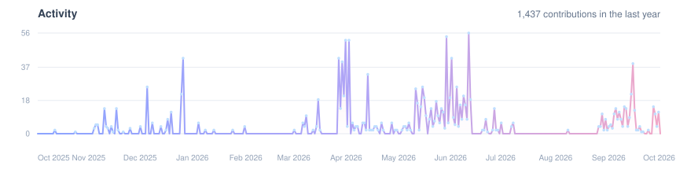

<em>疏影横斜水清浅，暗香浮动月黄昏。</em>

  
  
  

<!-- Banner slot reserved for a future narrow illustration or custom header -->

---

## About Me

> I am QianYan, someone who enjoys turning small sparks of inspiration into finished work.  
> More than adding flashy features, I care about whether a project has its own rhythm, structure, and aftertaste.

- 🎓 Transportation Engineering undergrad at **Zhengzhou University**, self-taught into AI engineering since 2024
- 🚦 Led **SafetyRAISE** — a provincial-level innovation project — from idea to deployment: 2 invention patents filed, and a handful of front-line traffic officers using it for real
- 🦀 Built a **Qwen inference framework from scratch in Rust** — weights, tokenizer, scheduling, speculative decoding, and the HTTP service, no framework in between — because I wanted to know what actually happens below the API
- 🛠️ Comfortable across the whole line — fine-tuning, RAG, agent workflows, full-stack, and the servers it all runs on

## Now

- 📄 Writing the SafetyRAISE work up into a paper — draft done, revising the experiments
- ⚙️ Keeping the deployed system alive and iterating on the retrieval side
- 🦀 Pushing `rsinfer` further: Qwen3.5 hybrid-attention support, verified MTP speculation, and honest validation boundaries over benchmark headlines
- 🎐 Still drawn to things where logic and imagination can stand side by side

## Featured Projects

### [SafetyRAISE-OS](https://github.com/QianYan-Art/SafetyRAISE-OS) 

`React` `FastAPI` `Agentic RAG` `YOLO + ByteTrack` `PostgreSQL`

A road-traffic accident analysis and report generation system. It carries accident photos and videos through a full pipeline — structured accident info, expert guidance, retrieval-augmented analysis, and exportable documents — with a YOLO + ByteTrack video path, hybrid sparse/dense retrieval, and per-user model configuration on PostgreSQL, built for local debugging, private deployment, and secondary development.

Built as a provincial innovation project I led end to end: **expert-small-model + LLM architecture**, a fine-tuned Qwen3-4B producing structured analysis checklists that guide the larger model through alternating retrieval. A report harness adds evidence snapshots, independent review and revision, budgets, and audit on top of the generation path. Two invention patents filed, one software copyright pending, deployed and still running.

### [SafetyRAISE-Lora](https://github.com/QianYan-Art/SafetyRAISE-Lora) 

`LoRA` `QLoRA` `Jetson Orin` `llama.cpp` `Evaluation`

The complete training assets for SafetyRAISE's report model: a rank-16 LoRA on the upper 32 layers of Qwen3.8-27B, trained entirely on a **single Jetson AGX Orin 64 GB**, merged and quantized to Q4_K_M GGUF and served with a retrained MTP draft head through a patched llama.cpp.

Everything needed to continue the work is here — synthetic SFT/RL datasets with lineage, the production prompt and schema assets, an evaluation harness with a live-environment simulator, llama.cpp decoding patches (adaptive draft length, draft vocabulary subsets), a technical report, and a handover guide that records what worked, what was falsified, and where the model still falls short of the teacher.

### [SafetyRAISE-LMEngine](https://github.com/QianYan-Art/SafetyRAISE-LMEngine) 

`Rust` `LLM Inference` `GGUF` `MTP` `HTTP/SSE`

A large-model inference framework written from scratch in Rust (crate `rsinfer`) — model weights, tokenizer, chat templates, request scheduling, generation state, and backend execution under one runtime contract. It serves as the expert small model behind SafetyRAISE while staying a readable reference implementation.

Supports safetensors and GGUF containers across Qwen2 / Qwen3 / Qwen3.5 text models (hybrid attention and GDN state managed by their own contracts), limited vision input, and Qwen3.5 MTP with full target-distribution verification and transactional rollback — speculative tokens are only published after verification commits. Ships a bounded scheduler with chunked prefill, a wgpu Q8 linear backend guarded by capability checks, and an OpenAI-style HTTP/SSE service subset with API-key auth — with validation evidence and experiment boundaries documented separately, not folded into the marketing.

## On Hugging Face

- [**TS-Dataset**](https://huggingface.co/shiqianyan/SafetyRAISE-TS-Qwen3) — SFT + DPO Chinese corpus for traffic-accident analysis, built from scratch across five categories
- [**SafetyRAISE-TS-Qwen3**](https://huggingface.co/shiqianyan/SafetyRAISE-TS-Qwen3) — the fine-tuned expert small model behind SafetyRAISE

<!-- Illustration slot reserved for a future transition image -->

## Activity

  <picture>
    <source media="(prefers-color-scheme: dark)" srcset="./assets/activity-dark.svg" />
    
  </picture>

---

  

